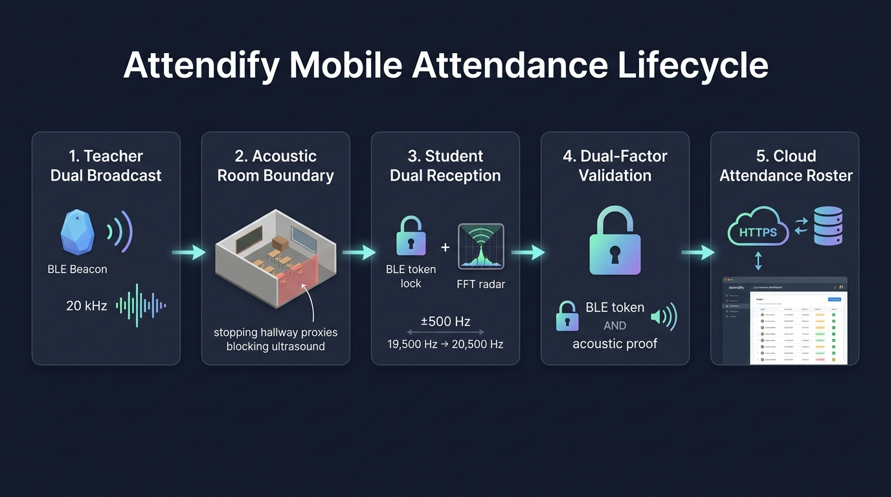

# 🎓 Attendify — Dual-Factor Mobile Attendance System

Attendify is a modern, zero-proxy classroom attendance mobile application built with **React Native (Expo)**, **Bluetooth Low Energy (BLE)**, and an **Inaudible 20,000 Hz Ultrasonic Acoustic Presence Radar**.

By combining short-range Bluetooth Low Energy with physical room-bounded ultrasound, Attendify guarantees that **only students physically sitting inside the classroom can mark attendance**, completely preventing proxy attendance from hallways, adjacent rooms, or outside the building.



---

## 🏛️ System Architecture Overview

```
┌────────────────────────────────────────────────────────────────────────────────────────┐
│                        ATTENDIFY DUAL-FACTOR PROXIMITY PIPELINE                        │
├───────────────────────────────────┬────────────────────────────────────────────────────┤
│         1. BLE BEACON             │            2. ULTRASONIC ACOUSTIC RADAR            │
│  Dynamic GATT characteristic      │  Silent 20,000 Hz acoustic carrier                 │
│  Cryptographic token discovery    │  Physically blocked by concrete walls & doors      │
│  Fast peripheral handshake        │  ±500 Hz error tolerance window (19.5 - 20.5 kHz)  │
└───────────────────────────────────┴────────────────────────────────────────────────────┘
```

The system operates across two coordinated layers:
1. **Mobile Application (`Attendify`)**: Runs on both Teacher and Student Android devices. Handles BLE advertising/scanning, ultrasound synthesis/detection, live telemetry, and local security.
2. **Cloud API Server (`backend`)**: Deployed on Render (`https://attendify-rebuild-backend-l9r4.onrender.com`). Validates token freshness, checks class membership, ensures duplicate protection, and provides real-time roster updates.

---

## 🔄 Complete Attendance Lifecycle (5 Stages)

```
[ Teacher Device ]                     [ Classroom Boundary ]                 [ Student Device ]
1. Broadcasts Dynamic BLE Token  ───>  BLE passes through walls         ───>  Locks BLE GATT token
2. Emits 20,000 Hz Sound Tone    ───>  ❌ BLOCKED by concrete walls/doors ───>  4096-pt FFT Radar verifies
                                                                             acoustic presence (±500 Hz)
                                                                                          │
                                                                                          ▼
                                                                             Dual-Factor Verified!
                                                                                          │
                                                                             POST /attendance/mark
                                                                                          ▼
                                                                             [ Render Cloud Backend ]
```

### Stage 1: Teacher Dual Broadcast
- The teacher opens the class on the app and taps **"Start Attendance"**.
- The backend generates a secure 32-character dynamic token (hashed in PostgreSQL with a configurable TTL, e.g., 120 seconds).
- The teacher's phone starts a **Bluetooth Low Energy (BLE) GATT server** advertising service `7d9d5b6d-b5f6-4f7a-8f07-a4fae2d9d0a1`.
- Simultaneously, the teacher's phone speaker emits an **inaudible 20,000 Hz continuous sine wave** with raised-cosine windowing to prevent speaker pop artifacts.

### Stage 2: Classroom Physical Boundary (The Acoustic Shield)
- Bluetooth 2.4 GHz radio waves easily pass through glass, drywall, and doors up to 30+ meters away, allowing hallway proxies in standard apps.
- **20,000 Hz near-ultrasound cannot penetrate concrete walls, solid doors, or closed windows.**
- This physical acoustic barrier ensures only sound waves reflecting inside the room reach student microphones.

### Stage 3: Student Dual-Sensor Reception
- When the student taps **"Scan & Mark Attendance"**, the app activates two hardware sensors in parallel:
  1. **Bluetooth Scanner**: Discovers the teacher's GATT peripheral and reads the rotating token.
  2. **Microphone Acoustic Radar**: Captures high-frequency room audio through a 17.2 kHz high-pass filter (stripping human speech, ambient noise, and AC hum) and executes a real-time **4096-point Fast Fourier Transform (FFT)**.

### Stage 4: &plusmn;500 Hz Frequency Error Tolerance & Cryptographic Lock
- To accommodate smartphone DAC clock skew, Doppler shifts from student movement, and multipath acoustic reflections, the FFT radar inspects an **86-bin wide spectral window between 19,500 Hz and 20,500 Hz**.
- Proximity is confirmed when the peak within this window achieves a Signal-to-Noise Ratio (SNR) &ge; 1.30 against guard noise floors (17.4 kHz and 21.2 kHz).
- The app requires **both** the BLE token lock **and** the acoustic proximity lock before unlocking the submission trigger.

### Stage 5: Cloud Synchronization & Live Roster
- The student app submits the verification payload via HTTPS:
  ```json
  POST /attendance/mark
  {
    "classId": "cm...class_id",
    "bleToken": "a3f9c2e1...",
    "ultrasoundVerified": true
  }
  ```
- The backend verifies the token hash against the active session, confirms the student is accepted in the class, checks session expiration, and prevents duplicate marks.
- The teacher's live dashboard updates immediately, displaying the newly present student.

---

## 🛠️ BLE Engine Hardening & Bug Fixes

The original mobile BLE implementation suffered from multiple critical bugs that have been completely re-engineered:
- **`[object Object]` Token Corruption Fixed**: `readCharacteristic()` returns an object `{ value: string, serviceUUID: string, characteristicUUID: string }`. The old codebase evaluated `hexToUtf8(String(value))`, outputting `"[object Object]"`. The new parser extracts `.value` safely before decoding.
- **Android `GATT_ERROR 133` Resolved**: Parallel connection attempts crash Android's native Bluetooth stack. Implemented `BleConnectionQueue` in `src/ble.ts` to serialize all GATT connections with retry fallbacks.
- **Hardware ScanFilter Compatibility**: Removed restrictive hardware-level UUID filters that fail silently on certain Android OEM chipsets, replacing them with software-level matching on Service UUID and local device names.

---

## 🔊 Ultrasonic Radar Specifications

- **Center Frequency:** 20,000 Hz (inaudible to human adults).
- **Error Tolerance Band:** &plusmn;500 Hz (**19,500 Hz – 20,500 Hz**).
- **Sampling Rate:** 48,000 Hz PCM mono audio.
- **FFT Size:** 4,096 points ($\approx 11.72\text{ Hz}$ resolution per bin).
- **Detection Bins:** Bins 1663 to 1749.
- **Threshold:** Signal-to-Noise Ratio (SNR) &ge; 1.30 above ambient guard floors (17.4 kHz and 21.2 kHz).
- **Fade Windows:** 25ms raised-cosine envelopes to eliminate audible speaker clicks.

---

## 🌐 Backend Architecture & Cloud Integration

The mobile app connects to the Attendify backend deployed on **Render**:
- **Production API URL:** `https://attendify-rebuild-backend-l9r4.onrender.com`

### Core Backend Endpoints Used by the Mobile App

| Endpoint | Method | Role | Description |
| :--- | :---: | :---: | :--- |
| `/auth/login` | `POST` | Public | Authenticates user and returns JWT token and role (`TEACHER` or `STUDENT`). |
| `/auth/register` | `POST` | Public | Registers a new teacher or student account. |
| `/auth/me` | `GET` | Authenticated | Retrieves profile of the currently logged-in user. |
| `/classes` | `POST` | Teacher | Creates a new class and generates a unique join code. |
| `/classes/teacher` | `GET` | Teacher | Lists all classes created by the logged-in teacher. |
| `/classes/student` | `GET` | Student | Lists all classes the student has joined or requested. |
| `/classes/join` | `POST` | Student | Submits a request to join a class using its join code. |
| `/classes/:id/requests` | `GET` | Teacher | Lists pending student enrollment requests for a class. |
| `/classes/:id/members/:mId` | `PATCH` | Teacher | Approves (`ACCEPTED`) or rejects (`REJECTED`) a student. |
| `/attendance/sessions/start` | `POST` | Teacher | Initiates an attendance session, creates a dynamic token, and starts the session TTL clock. |
| `/attendance/sessions/:id/end` | `POST` | Teacher | Manually terminates an ongoing attendance session. |
| `/attendance/classes/:id/current` | `GET` | Teacher | Real-time polling endpoint returning current active session and live list of attended students. |
| `/attendance/mark` | `POST` | Student | Validates session token hash + `ultrasoundVerified` proof and logs attendance. |
| `/attendance/student/history` | `GET` | Student | Returns past attendance records for the student. |

### Database Entities (PostgreSQL via Prisma)
- **`User`**: Account identity (id, name, email, passwordHash, role: TEACHER / STUDENT).
- **`Class`**: Classroom entity owned by a teacher (id, name, code, teacherId).
- **`ClassMembership`**: Student-to-Class relation (status: PENDING, ACCEPTED, REJECTED).
- **`AttendanceSession`**: Live attendance window (id, classId, teacherId, tokenHash, expiresAt, endedAt).
- **`Attendance`**: Verified attendance entry (id, sessionId, studentId, markedAt).

---

## 📱 Mobile Tech Stack

- **Framework:** Expo 57 / React Native 0.86 (New Architecture enabled).
- **Routing:** Expo Router 57 (file-based navigation with typed routes).
- **Bluetooth:** `react-native-bluetooth-ble` + `react-native-nitro-modules` (C++ JSI TurboModules).
- **Acoustics / DSP:** Web Audio API (`AudioContext`, `BiquadFilter`, `AnalyserNode` FFT) hosted in headless radar component (`UltrasoundRadar.tsx`).
- **State & Storage:** `expo-secure-store` for encrypted JWT persistence.
- **Language:** TypeScript 5.8 (Strict type checking, 0 errors).

---

## 📂 Mobile Project Structure

```
Attendify/
├── android/                         # Android native project
│   ├── app/
│   │   ├── attendify-release.keystore # Production release keystore
│   │   ├── build.gradle             # Signing configuration & dependencies
│   │   └── src/main/AndroidManifest.xml # Permissions (Bluetooth, Mic, Location)
│   ├── gradle.properties            # JVM args, architecture settings, credentials
│   └── build.gradle
├── app/                             # Expo Router UI screens
│   ├── _layout.tsx                  # Global theme provider & navigation stack
│   ├── index.tsx                    # Entry point & session routing
│   ├── (auth)/
│   │   ├── login.tsx                # Teacher/Student login screen
│   │   └── register.tsx             # Account registration screen
│   ├── (student)/
│   │   ├── dashboard.tsx            # Student class list & join class modal
│   │   └── class/[id].tsx           # Dual-telemetry scan & radar lock screen
│   └── (teacher)/
│       ├── _layout.tsx
│       ├── dashboard.tsx            # Teacher dashboard & class cards
│       ├── create-class.tsx         # Class creation form
│       ├── class/[id].tsx           # Active session, BLE emitter & live student roster
│       └── class/[id]/requests.tsx  # Student membership approval management
├── src/                             # Core Application Logic
│   ├── api.ts                       # REST API client with automatic JWT bearer handling
│   ├── attendance.ts                # Coordinated BLE + Ultrasound attendance verification
│   ├── auth.tsx                     # Authentication context & persistent session provider
│   ├── ble.ts                       # Hardened BLE GATT peripheral & scanner engine
│   ├── ultrasound.ts                # 20 kHz synthesizer & Web Audio FFT DSP helpers
│   └── UltrasoundRadar.tsx          # Dual-mode acoustic radar component
├── attendance_lifecycle_chart.jpg   # Infographic architecture diagram
├── attendance_lifecycle.html        # Interactive visual lifecycle widget
├── Attendify-release.apk            # Pre-compiled, signed production APK (~39.7 MB)
├── app.json                         # Expo application manifest & permissions
├── package.json
└── tsconfig.json
```

---

## 🚀 Getting Started

### Prerequisites
- Node.js &ge; 20.x
- Android SDK (API 34+ / Build-Tools 36.0.0)
- Physical Android smartphone (BLE Central/Peripheral and microphone hardware required for physical testing)

### 1. Install Dependencies
```bash
npm install
```

### 2. Configure Environment
Create a `.env` file in the `Attendify` root:
```env
EXPO_PUBLIC_API_URL=https://attendify-rebuild-backend-l9r4.onrender.com
```

### 3. Run in Development Mode
```bash
# Start Metro bundler with dev client
npm run start

# Launch directly onto connected Android device
npm run android
```

---

## 📦 Pre-Built Production Signed APK

A fully compiled, production-signed release APK is ready for immediate deployment and testing:

- **File Path:** [`Attendify-release.apk`](Attendify-release.apk) (in this directory)
- **Architecture:** `arm64-v8a`
- **Signature:** Android APK Signature Scheme v2 verified (`apksigner verify: true`)
- **Backend Connected:** `https://attendify-rebuild-backend-l9r4.onrender.com`

### How to Install:
- **Via ADB:**
  ```powershell
  adb install -r Attendify-release.apk
  ```
- **Direct Phone Transfer:** Copy `Attendify-release.apk` to any Android phone via USB, Google Drive, or WhatsApp, and tap to install.
